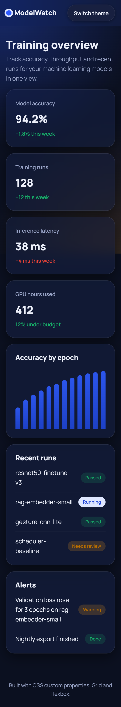
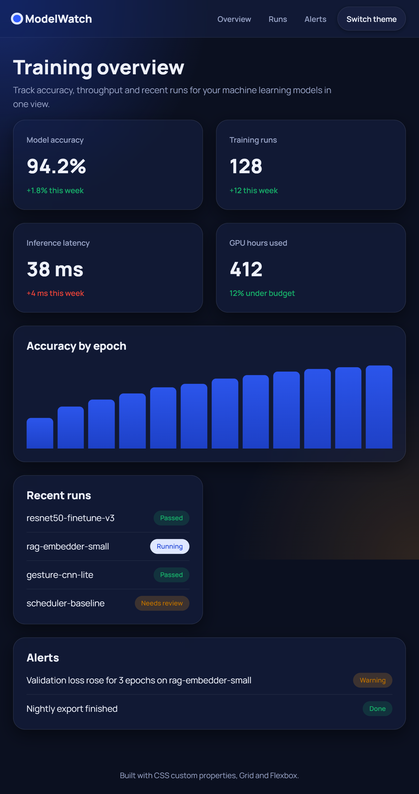
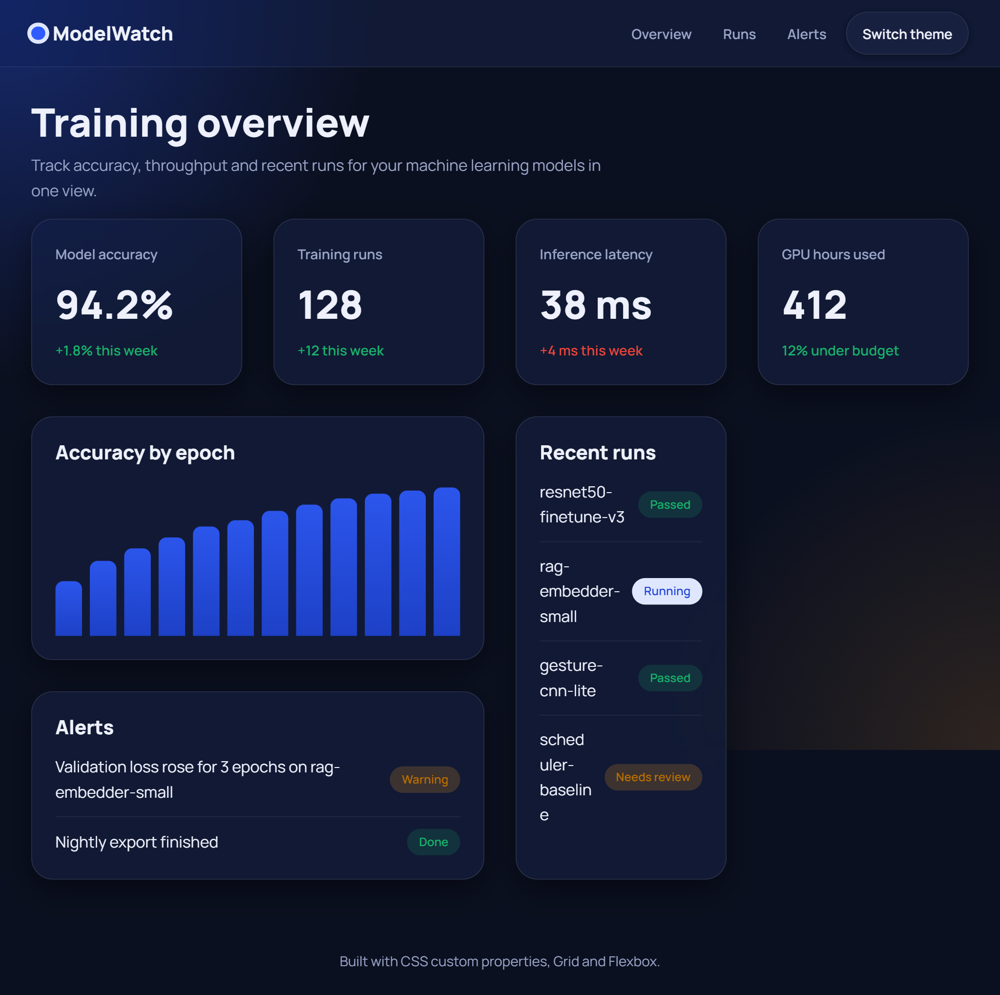
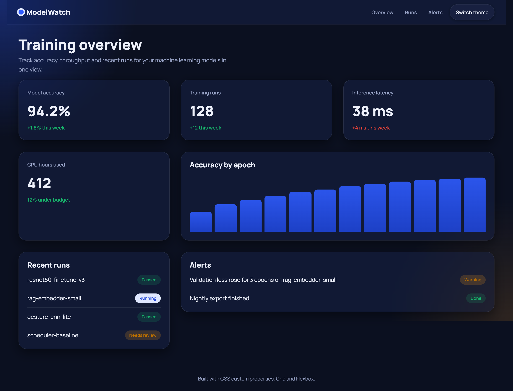

# Responsive Design Tokens & Mobile-First CSS Architecture

A responsive dashboard styled entirely with CSS custom properties (design tokens), CSS Grid and Flexbox.

## Features
- **Design tokens** in `:root`: brand colors, fluid type scale, spacing scale, border radii, motion
- **Mobile-first grid** with breakpoints at 320px (1 column), 768px (2), 1024px (4) and 1440px (6)
- **Glassmorphism** cards using `backdrop-filter`, soft shadows and hover transitions
- **Light/dark themes** through theme variables, following the OS setting with a manual toggle
- **No horizontal scrolling** on mobile: `minmax(0, 1fr)` grid tracks, `min-width: 0` on cards, wrapping flex rows, `overflow-wrap`

## Run
Open `index.html` in a browser. No build step.

## Screenshots
Add your screenshots to `screenshots/`:
| Mobile 320px | Tablet 768px | Laptop 1024px | Desktop 1440px |
|---|---|---|---|
|  |  |  |  |
